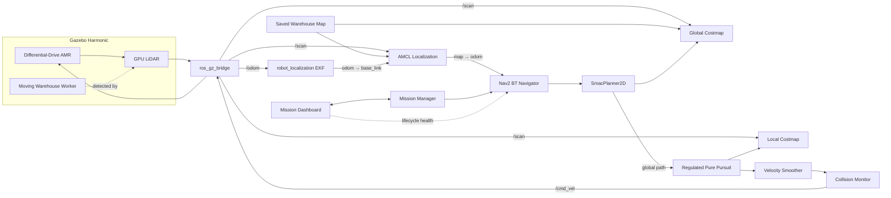

# Autonomous Warehouse AMR — ROS 2 Jazzy + Gazebo Harmonic

An autonomous mobile robot (AMR) simulation for warehouse navigation, mission execution, and dynamic-obstacle handling.

The project combines **ROS 2 Jazzy**, **Gazebo Harmonic**, **Nav2**, **AMCL**, **robot_localization**, a simulated **2D GPU LiDAR**, a mission manager, and an operator dashboard. The robot can autonomously navigate between warehouse stations, execute configurable missions, react to moving obstacles, and be launched as a complete system from a single command.

## Highlights

- Differential-drive warehouse robot
- Gazebo Harmonic simulation
- 2D GPU LiDAR
- Saved occupancy-grid map
- AMCL localization
- EKF-based odometry / TF pipeline
- Nav2 autonomous navigation
- **SmacPlanner2D** global planner
- **Regulated Pure Pursuit (RPP)** controller
- Local and global obstacle-aware costmaps
- Collision Monitor safety layer
- Mission execution from YAML files
- PICKUP / INSPECTION / DROPOFF / HOME workflow
- Mission retry, pause, resume, cancel, and status handling
- Tkinter operator dashboard
- Automatic initial localization
- One-command system launch
- Optional moving warehouse worker for dynamic-obstacle testing

## System Architecture



## Robot

The simulated platform is a compact differential-drive mobile robot with:

- Chassis: approximately **0.40 m × 0.30 m**
- Two driven wheels
- Passive caster
- Wheel radius: **0.075 m**
- 2D GPU LiDAR
- Differential-drive Gazebo plugin
- Odometry and TF publication

## Navigation Stack

| Component | Configuration |
|---|---|
| Localization | AMCL |
| Global planner | SmacPlanner2D |
| Local controller | Regulated Pure Pursuit |
| Odometry filtering | robot_localization EKF |
| Local costmap | Rolling obstacle-aware costmap |
| Global costmap | Static + obstacle + inflation layers |
| Safety | Nav2 Collision Monitor |
| Behavior management | Nav2 BT Navigator |

The final RPP + SmacPlanner2D setup is the stable navigation baseline for this project.

## Mission System

Mission definitions are stored in YAML files. A delivery mission follows:

```text
PICKUP → SHELFA → DROPOFF → HOME
```

The mission manager supports:

- Mission state tracking
- Navigation retries
- Station actions
- Pause / resume
- Mission cancellation
- Mission logging
- ROS topic status publication
- Multiple YAML mission definitions

Mission states:

```text
IDLE
NAVIGATING
PAUSED
AT_STATION
COMPLETED
CANCELED
FAILED
```

## Operator Dashboard

The dashboard provides:

- Mission selection
- Start / Pause / Resume / Cancel
- Current station
- Next station
- Mission progress
- Loop progress
- Elapsed time
- Event log
- Nav2 lifecycle health monitoring

## Dynamic Obstacle Scenario

The optional animated warehouse worker follows a scripted Gazebo actor trajectory and is detected by the robot's GPU LiDAR.

When the worker intersects the robot's path:

1. LiDAR detects the moving obstacle.
2. The obstacle is inserted into the costmap.
3. RPP detects a potential collision.
4. Collision Monitor reduces or blocks motion when required.
5. The robot continues once the path becomes safe.

## Repository Structure

```text
warehouse_ws/
├── README.md
├── .gitignore
├── maps/
│   ├── warehouse_map.pgm
│   └── warehouse_map.yaml
├── missions/
│   ├── delivery.yaml
│   ├── inspection.yaml
│   └── patrol.yaml
├── mission_points.yaml
└── src/
    ├── warehouse_robot_description/
    │   ├── config/
    │   │   ├── ekf.yaml
    │   │   ├── gz_bridge.yaml
    │   │   ├── nav2_params.yaml
    │   │   └── slam_params.yaml
    │   ├── launch/
    │   │   ├── auto_initial_pose.py
    │   │   ├── gazebo.launch.py
    │   │   ├── gazebo_headless.launch.py
    │   │   └── warehouse_system.launch.py
    │   ├── models/
    │   │   └── moving_agv.sdf
    │   ├── rviz/
    │   ├── urdf/
    │   │   └── robot.urdf
    │   ├── worlds/
    │   │   └── warehouse_world.sdf
    │   ├── CMakeLists.txt
    │   └── package.xml
    └── warehouse_robot_missions/
        ├── warehouse_robot_missions/
        │   ├── mission_dashboard.py
        │   ├── pose_recorder.py
        │   └── warehouse_mission.py
        ├── resource/
        ├── setup.cfg
        ├── setup.py
        └── package.xml
```

> `moving_agv.sdf` currently contains the tested moving warehouse-worker actor. Rename it only if the launch-file path is updated too.

## Requirements

Recommended environment:

- Ubuntu / WSL2
- ROS 2 Jazzy
- Gazebo Harmonic
- Nav2
- ros_gz
- robot_localization
- SLAM Toolbox
- Python 3
- Tkinter
- PyYAML

Typical dependencies:

```bash
sudo apt update

sudo apt install \
  ros-jazzy-navigation2 \
  ros-jazzy-nav2-bringup \
  ros-jazzy-nav2-smac-planner \
  ros-jazzy-nav2-regulated-pure-pursuit-controller \
  ros-jazzy-ros-gz \
  ros-jazzy-robot-localization \
  ros-jazzy-slam-toolbox \
  python3-tk \
  python3-yaml
```

## Build

```bash
cd ~/warehouse_ws
source /opt/ros/jazzy/setup.bash
colcon build --symlink-install
source install/setup.bash
```

## Run

### Standard headless simulation

```bash
source /opt/ros/jazzy/setup.bash
source ~/warehouse_ws/install/setup.bash

ros2 launch warehouse_robot_description warehouse_system.launch.py
```

### Gazebo GUI

```bash
source /opt/ros/jazzy/setup.bash
source ~/warehouse_ws/install/setup.bash

QT_QPA_PLATFORM=xcb ros2 launch \
  warehouse_robot_description warehouse_system.launch.py \
  headless:=False
```

### Gazebo GUI + moving warehouse worker

```bash
source /opt/ros/jazzy/setup.bash
source ~/warehouse_ws/install/setup.bash

QT_QPA_PLATFORM=xcb ros2 launch \
  warehouse_robot_description warehouse_system.launch.py \
  headless:=False \
  dynamic_obstacle:=True
```

## Run a Mission from the CLI

```bash
source /opt/ros/jazzy/setup.bash
source ~/warehouse_ws/install/setup.bash

ros2 run warehouse_robot_missions warehouse_mission delivery
```

## Validation

The system has been tested with:

- Complete multi-station delivery missions
- Repeated autonomous navigation
- Automatic AMCL initialization
- SmacPlanner2D path generation
- RPP path tracking
- Dynamic human-crossing scenario
- Collision prediction / monitoring
- Mission pause, resume, cancel, and retry behavior

## Known Notes

- Gazebo GUI under WSL is heavier than headless mode.
- Headless mode is recommended for repeatable navigation tests.
- After an interrupted launch, make sure old Gazebo / ROS processes are not still running before starting another simulation.
- Do not commit generated `build/`, `install/`, `log/`, Python cache, or mission log files.

## Future Work

This repository intentionally remains focused on a single autonomous warehouse AMR.

Future work is better suited to a second project:

- Camera perception
- YOLO object detection
- Jetson integration
- Autonomous visual inspection
- Multi-robot fleet management
- Automatic docking / charging
- Real hardware integration

## Project Status

**Completed first autonomous mobile robot project.**

Core navigation, localization, mission control, operator interface, dynamic-obstacle response, and one-command startup are functional.

---

Built as a robotics learning and portfolio project using ROS 2, Gazebo, and Nav2.
